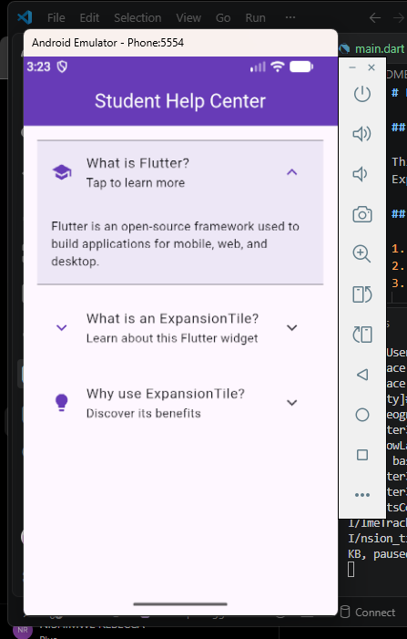

# Flutter ExpansionTile Demo

## Project Description

This project is a simple Student Help Center app built using Flutter. It demonstrates how the ExpansionTile widget allows users to expand and collapse questions to view additional information.

## How to Run the App

1. Clone this repository.

`git clone https://github.com/EKIRABO/flutter-expansiontile-demo.git` 

2. Open the project in VS Code or Android Studio.
3. Open the terminal and run:

   `flutter pub get`

4. Start an emulator or connect a device.
5. Run the application using:

   `flutter run`

## Three ExpansionTile Properties

**1. title**

The `title` property displays the main text of the ExpansionTile. In my app, it displays the questions that users can tap.

**2. initiallyExpanded**

This property determines whether the tile starts open or closed. When set to `false`, the answer is initially hidden.

**3. backgroundColor**

This property changes the background color when the tile is expanded. I used a light purple color to make the expanded section stand out.

## Screenshot

